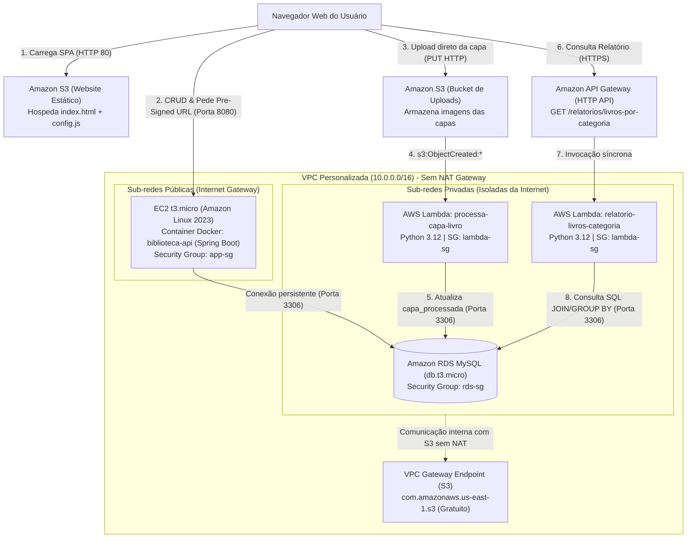

# Sistema de Gestão de Biblioteca em Nuvem (AWS Learner Lab)

> **Projeto 2 - Disciplina de Serviço em Nuvem | Turma 5J11**  
> Aplicação distribuída publicada na AWS (Learner Lab) integrando computação em containers (EC2 + Docker), banco de dados relacional em rede privada (Amazon RDS MySQL), armazenamento de objetos (Amazon S3), arquitetura orientada a eventos e serverless (AWS Lambda + API Gateway) e front-end web dinâmico.

---

## 1. Visão Geral do Sistema e Domínio de Negócio

### 1.1. O Problema
Bibliotecas universitárias enfrentam dificuldades na organização física e digital do acervo:
- Livros cadastrados sem capas ou com capas desatualizadas.
- Falta de visibilidade analítica em tempo real sobre a distribuição de títulos por categoria.
- Sistemas tradicionais que sobrecarregam o servidor principal ao trafegar arquivos pesados de imagem através da API.

### 1.2. A Solução
Um sistema em nuvem moderno, seguro e de baixo custo, estruturado sobre os serviços da AWS:
1. **Catálogo Relacional:** Cadastro e manutenção de **Categorias** e **Livros** (relação 1:N com chave estrangeira garantindo integridade referencial).
2. **Upload Desacoplado:** O navegador obtém uma **Pre-Signed URL** segura emitida pelo backend e transfere a capa do livro direto para o bucket S3, sem trafegar bytes de imagem pelo servidor da API.
3. **Processamento Serverless em Background:** Ao chegar uma nova capa no S3, um evento dispara automaticamente uma **função Lambda**, que extrai metadados do arquivo e atualiza o livro no banco de dados privado.
4. **Relatório Analítico:** Uma segunda função Lambda acionada via **API Gateway** executa uma agregação SQL (`JOIN` e `GROUP BY`) no banco relacional para expor o total de exemplares e capas ativas por categoria.
5. **Interface Web Intuitiva:** Publicada em hospedagem estática no S3, operando tanto o CRUD das entidades quanto os uploads e relatórios de forma reativa e tolerante à reinicialização de sessões do Learner Lab.

---

## 2. O que Cada Componente Faz na Arquitetura



| Componente AWS | Função e Responsabilidade Técnica no Projeto |
|---|---|
| **Amazon VPC (`10.0.0.0/16`)** | Rede isolada criada especificamente para o projeto, particionada em sub-redes públicas (com rota para o Internet Gateway) e sub-redes privadas (sem saída externa direta). |
| **VPC Gateway Endpoint para o S3** | Rota interna gratuita adicionada à tabela de rotas da VPC. Permite que as Lambdas e a EC2 se comuniquem com os buckets S3 de dentro da rede privada sem precisar de um caro NAT Gateway. |
| **Amazon EC2 (`t3.micro`)** | Instância virtual na subnet pública executando o Docker. Roda o container da API Spring Boot de forma contínua, mantendo o pool de conexões persistente (HikariCP) com o RDS (ADR-01). Usa a role `LabInstanceProfile`. |
| **Amazon RDS MySQL (`db.t3.micro`)** | Banco relacional provisionado em **sub-rede estritamente privada** (`Acesso público: Não`). Armazena as tabelas `categorias` e `livros`. Só aceita tráfego na porta 3306 vindo do `app-sg` e do `lambda-sg`. |
| **Amazon S3 - Bucket do Front-end** | Bucket público configurado com *Static Website Hosting*. Armazena o `index.html` e o arquivo desacoplado `config.js`. |
| **Amazon S3 - Bucket de Uploads** | Bucket privado dedicado ao armazenamento das capas dos livros (`capas/livro-{id}.jpg`). Possui política de CORS aberta para o método `PUT`, permitindo que o navegador envie arquivos diretamente. |
| **AWS Lambda: `processa-capa-livro`** | Função Serverless Python 3.12 acionada pelo gatilho do S3. Extrai o ID do livro e o tamanho do arquivo, conecta ao RDS via VPC privada e atualiza as colunas de capa do livro com logs completos no CloudWatch. |
| **AWS Lambda: `relatorio-livros-categoria`** | Função Serverless Python 3.12 responsável por executar a query de inteligência de negócio (`LEFT JOIN` + `GROUP BY`). Retorna o JSON analítico com cabeçalhos de CORS. |
| **Amazon API Gateway (HTTP API)** | Gateway gerenciado que expõe a rota pública `GET /relatorios/livros-por-categoria`, conectando com a Lambda de relatório e gerenciando o preflight CORS do navegador. |

---

## 3. Detalhamento dos Três Processos Principais

### Processo 1: Upload de Capa via Pre-Signed URL (RF-02)
Em vez de sobrecarregar o backend enviando megabytes de arquivos binários através do Spring Boot, o fluxo ocorre em três etapas leves:
1. O usuário seleciona o livro e a imagem no navegador e clica em salvar.
2. O front-end faz um `POST /livros/{id}/capa-url` para o backend na EC2.
3. O backend utiliza o **AWS SDK S3** (com credenciais automáticas do `LabInstanceProfile`) e gera uma **Pre-Signed URL** temporária assinada criptograficamente, válida por 10 minutos para a chave `capas/livro-{id}.jpg`.
4. O navegador recebe essa URL e faz uma requisição HTTP `PUT` enviando os bytes da imagem diretamente para o Amazon S3.

### Processo 2: Processamento Assíncrono Orientado a Eventos (RF-03)
1. No momento exato em que o upload no S3 termina com sucesso, o S3 emite o evento `s3:ObjectCreated:Put`.
2. O evento aciona a função Lambda `processa-capa-livro`.
3. A Lambda (que roda dentro da VPC privada com a role `LabRole`) recebe o JSON do evento, extrai a chave do arquivo e o tamanho em bytes.
4. Conecta-se ao RDS MySQL na porta 3306 e executa:
   ```sql
   UPDATE livros 
   SET capa_url = 'https://<bucket>.s3.amazonaws.com/capas/livro-X.jpg',
       capa_processada = TRUE,
       capa_tamanho_bytes = 154200
   WHERE id = X;
   ```
5. Todas as etapas emitem logs estruturados para o **Amazon CloudWatch Logs**.

### Processo 3: Relatório Agregado em Nuvem (RF-04)
1. O usuário clica em "Consultar Relatório" na interface web.
2. O navegador dispara uma requisição `GET /relatorios/livros-por-categoria` para o endpoint do **Amazon API Gateway**.
3. O API Gateway aciona de forma síncrona a Lambda `relatorio-livros-categoria`.
4. A Lambda consulta o RDS através da query:
   ```sql
   SELECT 
       c.id AS categoria_id,
       c.nome AS categoria_nome,
       COUNT(l.id) AS total_livros,
       COALESCE(SUM(CASE WHEN l.capa_processada = 1 THEN 1 ELSE 0 END), 0) AS capas_processadas
   FROM categorias c
   LEFT JOIN livros l ON l.categoria_id = c.id
   GROUP BY c.id, c.nome
   ORDER BY total_livros DESC, c.nome ASC;
   ```
5. A função formata o resultado em JSON, injeta os cabeçalhos de CORS (`Access-Control-Allow-Origin: *`) e responde ao navegador, que desenha os cards analíticos na tela.

---

## 4. Matriz de Rastreabilidade dos Requisitos

| Requisito | Descrição | Onde está implementado / atendido |
|---|---|---|
| **RF-01** | CRUD de 2 entidades relacionadas (1:N) no RDS | `backend/src/...` (Categorias e Livros em Spring Boot + JPA), `sql/001_schema.sql` e modal de categorias no `index.html`. |
| **RF-02** | Upload via Pre-Signed URL gerada pelo backend | `S3Service.java`, endpoint `POST /livros/{id}/capa-url` no `LivroController.java` e upload via `PUT` no `index.html`. |
| **RF-03** | S3 dispara Lambda que grava no RDS com logs | `lambdas/processa_capa/lambda_function.py`, gatilho S3 no console e script SQL `sql/003_add_capa_columns.sql`. |
| **RF-04** | Relatório exposto pelo API Gateway via Lambda (JOIN/GROUP BY) | `lambdas/relatorio/lambda_function.py` e rota configurada no Amazon API Gateway. |
| **RF-05** | Front-end web consumindo a API publicado na nuvem | `index.html` e `config.js` hospedados no bucket S3 Static Website. |
| **RNF-01** | RDS em subnet privada e Security Groups documentados | Subnet Group privada no RDS; Security Groups `app-sg`, `rds-sg` e `lambda-sg` detalhados na Seção 5. |
| **RNF-02** | Nenhuma senha ou chave no repositório | `.gitignore` configurado; credenciais via variáveis de ambiente no container e roles do IAM (`LabRole` e `LabInstanceProfile`). |
| **RNF-03** | Sistema volta a funcionar após nova sessão sem IP fixo | Variáveis dinâmicas isoladas no arquivo `config.js` no S3 e variáveis de ambiente na EC2. |
| **RNF-04** | Decisão Justificada (ADR): CRUD em EC2 Docker vs Lambda | Registrado e fundamentado no [specs/design.md](specs/design.md#L93-L107) (ADR-01). |
| **RNF-05** | Não usar IaC; criação documentada passo a passo no README | Detalhado integralmente na Seção 5 deste documento. |

---

## 5. Guia de Provisionamento Passo a Passo no Console AWS (RNF-05)

Siga este roteiro no console da AWS (`us-east-1`):

### 5.1. Rede (VPC)
1. Acesse o serviço **VPC** e clique em **Criar VPC**.
2. Escolha a opção **VPC e muito mais**:
   - **Nome:** `projeto02-vpc`
   - **Bloco CIDR IPv4:** `10.0.0.0/16`
   - **Zonas de Disponibilidade (AZs):** `2`
   - **Sub-redes públicas:** `2`
   - **Sub-redes privadas:** `2`
   - **Gateways NAT:** `Nenhum`
   - **Endpoints de VPC:** Marque **Gateway do S3**.
3. Clique em **Criar VPC**.

### 5.2. Grupos de Segurança (Security Groups)
Acesse **VPC > Grupos de segurança** e crie os três grupos:

1. **`app-sg`** (para a EC2):
   - VPC: `projeto02-vpc`
   - Entrada: TCP 8080 (Origem: `0.0.0.0/0`), HTTP 80 (Origem: `0.0.0.0/0`), SSH 22 (Origem: `0.0.0.0/0`).
2. **`lambda-sg`** (para as Lambdas):
   - VPC: `projeto02-vpc`
   - Entrada: Nenhuma necessária. Saída: Todo o tráfego.
3. **`rds-sg`** (para o RDS MySQL):
   - VPC: `projeto02-vpc`
   - Entrada:
     - MySQL/Aurora (Porta 3306) | Origem: selecione o grupo `app-sg`.
     - MySQL/Aurora (Porta 3306) | Origem: selecione o grupo `lambda-sg`.

### 5.3. Banco de Dados (Amazon RDS MySQL)
1. Acesse **RDS > Grupos de sub-redes** e crie `projeto02-db-subnet-group`:
   - VPC: `projeto02-vpc`
   - Sub-redes: Selecione **apenas as 2 sub-redes privadas**.
2. Acesse **RDS > Criar banco de dados**:
   - Mecanismo: `MySQL` (Versão 8.0 ou 8.4)
   - Modelo: `Nível gratuito`
   - Identificador: `projeto02-db`
   - Usuário: `admin` | Senha: (defina uma senha forte)
   - Instância: `db.t3.micro` | Armazenamento: `20 GiB` (desmarque autoescalar)
   - Conectividade: VPC `projeto02-vpc`, Subnet Group `projeto02-db-subnet-group`.
   - **Acesso público:** **Não** (fundamental para o RNF-01).
   - Security Group: Selecione apenas `rds-sg`.
   - Configuração adicional: Nome do banco inicial: `projeto`.
3. Conclua a criação e anote o **Endpoint** gerado.

### 5.4. Buckets de Armazenamento (Amazon S3)
Crie dois buckets em `us-east-1`:
1. **Bucket Frontend** (ex: `biblioteca-frontend-turma5j11-2026`):
   - Desmarque *Bloquear todo o acesso público*.
   - Em *Propriedades*, ative **Hospedagem de site estático** (índice: `index.html`).
   - Em *Permissões*, insira a política de leitura pública:
     ```json
     {
       "Version": "2012-10-17",
       "Statement": [{
         "Sid": "PublicRead",
         "Effect": "Allow",
         "Principal": "*",
         "Action": "s3:GetObject",
         "Resource": "arn:aws:s3:::SEU-BUCKET-FRONTEND/*"
       }]
     }
     ```
2. **Bucket Uploads** (ex: `biblioteca-uploads-turma5j11-2026`):
   - Mantenha o acesso público **bloqueado**.
   - Em *Permissões > CORS*, insira:
     ```json
     [
       {
         "AllowedHeaders": ["*"],
         "AllowedMethods": ["GET", "PUT", "POST"],
         "AllowedOrigins": ["*"],
         "ExposeHeaders": ["ETag"]
       }
     ]
     ```

### 5.5. Servidor da API (Amazon EC2 + Docker)
1. Acesse **EC2 > Executar instâncias**:
   - Nome: `biblioteca-api-ec2` | AMI: `Amazon Linux 2023` | Tipo: `t3.micro`
   - Rede: VPC `projeto02-vpc`, sub-rede pública, Atribuir IP público: `Habilitar`.
   - Security Group: `app-sg`.
   - Detalhes Avançados > Perfil de Instância IAM: `LabInstanceProfile`.
2. Conecte na EC2 via *EC2 Instance Connect* e execute:
   ```bash
   sudo dnf update -y && sudo dnf install -y docker mariadb105
   sudo systemctl enable --now docker
   sudo usermod -aG docker ec2-user
   ```
3. Clone o projeto e popule o banco:
   ```bash
   git clone https://github.com/levig-0/p2_servico_em_nuvem.git
   cd p2_servico_em_nuvem
   mysql -h <ENDPOINT-RDS> -u admin -p projeto < sql/001_schema.sql
   mysql -h <ENDPOINT-RDS> -u admin -p projeto < sql/002_schema.sql
   mysql -h <ENDPOINT-RDS> -u admin -p projeto < sql/003_add_capa_columns.sql
   ```
4. Gere o pacote e inicie o container:
   ```bash
   cd backend
   ./mvnw clean package -DskipTests
   docker build -t biblioteca-api .
   docker run -d --name biblioteca-api \
     -p 8080:8080 \
     --restart unless-stopped \
     -e DB_HOST="<ENDPOINT-RDS>" \
     -e DB_USER="admin" \
     -e DB_PASSWORD="<SENHA-RDS>" \
     -e DB_NAME="projeto" \
     -e AWS_REGION="us-east-1" \
     -e AWS_S3_UPLOADS_BUCKET="<SEU-BUCKET-UPLOADS>" \
     biblioteca-api
   ```

### 5.6. Funções Serverless (AWS Lambda e API Gateway)

#### 1. Gerar os pacotes `.zip`:
No repositório local ou na máquina de desenvolvimento, execute:
```bash
chmod +x lambdas/empacotar.sh
./lambdas/empacotar.sh
```
Isso gerará `lambdas/processa_capa.zip` e `lambdas/relatorio.zip`.

#### 2. Criar a Lambda `processa-capa-livro`:
- Runtime: `Python 3.12` | Role: `LabRole`
- Configuração de VPC: `projeto02-vpc`, sub-redes **privadas**, Security Group `lambda-sg`.
- Variáveis de ambiente: `DB_HOST`, `DB_USER`, `DB_PASSWORD`, `DB_NAME`.
- Código: Faça upload do arquivo `lambdas/processa_capa.zip`.
- Gatilho: Adicionar S3 > Selecione o bucket de uploads > Evento: `All object create events` > Prefixo: `capas/`.

#### 3. Criar a Lambda `relatorio-livros-categoria`:
- Runtime: `Python 3.12` | Role: `LabRole`
- Configuração de VPC: `projeto02-vpc`, sub-redes **privadas**, Security Group `lambda-sg`.
- Variáveis de ambiente: `DB_HOST`, `DB_USER`, `DB_PASSWORD`, `DB_NAME`.
- Código: Faça upload do arquivo `lambdas/relatorio.zip`.

#### 4. Criar o API Gateway:
- Acesse **API Gateway** > Criar API HTTP (`biblioteca-api-gateway`).
- Crie a rota `GET /relatorios/livros-por-categoria` integrada com a Lambda `relatorio-livros-categoria`.
- No menu lateral **CORS**, configure:
  - Origens: `*`
  - Métodos: `GET, OPTIONS`
  - Cabeçalhos: `*`
- Anote a URL de Invocação gerada (ex: `https://xyz.execute-api.us-east-1.amazonaws.com`).

### 5.7. Publicar o Front-end no S3
1. Abra o arquivo `config.js` e preencha:
   ```javascript
   const CONFIG = {
       API_BASE_URL: "http://<IP-PUBLICO-EC2>:8080",
       APIGW_URL: "https://<ID-API-GATEWAY>.execute-api.us-east-1.amazonaws.com"
   };
   ```
2. Envie `index.html` e `config.js` para o bucket S3 do front-end:
   ```bash
   aws s3 cp index.html s3://<SEU-BUCKET-FRONTEND>/index.html
   aws s3 cp config.js s3://<SEU-BUCKET-FRONTEND>/config.js
   ```
3. Acesse a URL do site estático no navegador.

---

## 6. Procedimento de Reinicialização de Sessão (Learner Lab - RNF-03)

O Learner Lab encerra as sessões a cada 4 horas e altera o IP público da EC2 ao religar. Para retomar a aplicação em **menos de 2 minutos** sem reinstalar nada:

1. **Religue a EC2** pelo console da AWS (o container Docker sobe sozinho graças à flag `--restart unless-stopped`).
2. Copie o **novo IP público** da EC2.
3. Altere apenas a primeira linha do arquivo local `config.js`:
   ```javascript
   API_BASE_URL: "http://<NOVO-IP-EC2>:8080",
   ```
4. Atualize o arquivo no bucket S3 do front-end:
   ```bash
   aws s3 cp config.js s3://<SEU-BUCKET-FRONTEND>/config.js
   ```
5. Pronto! Ao dar refresh no navegador, todo o sistema já estará comunicando com a nova sessão.

---

## 7. Roteiro de Testes e Validação

### Teste 1: CRUD de Categorias e Livros (RF-01)
- Na interface web, clique em **"Gerenciar Categorias"**, cadastre uma categoria (ex: "Ficção") e verifique se ela aparece no modal.
- Cadastre um novo livro associado a essa categoria.
- Tente excluir a categoria: o sistema exibirá o alerta informando que a restrição de chave estrangeira do banco impediu a exclusão, comprovando a integridade relacional.

### Teste 2: Upload Direto no S3 (RF-02)
- No formulário de cadastro, preencha os dados de um novo livro e selecione uma foto de capa (`.jpg` ou `.png`).
- Ao clicar em salvar, acompanhe no console do navegador (F12 > Network) a emissão da URL pré-assinada (`POST /livros/{id}/capa-url`) e a requisição subsequente com método `PUT` transferindo a imagem diretamente para o S3.

### Teste 3: Processamento por Evento e CloudWatch (RF-03)
- No console da AWS, abra o **CloudWatch Logs** e entre no grupo de logs `/aws/lambda/processa-capa-livro`.
- Veja a linha de log comprovando que o evento S3 disparou a execução e o registro no banco foi atualizado (`capa_processada = TRUE`).
- Na tela da aplicação, o livro recém-criado exibirá a imagem da capa e o badge verde *"Capa Processada (S3)"*.

### Teste 4: Relatório com JOIN e GROUP BY (RF-04)
- Clique no botão **"Consultar Relatório"**.
- O front-end invocará a URL do API Gateway e renderizará os cards agrupados exibindo o nome de cada categoria, o total de livros e quantas capas foram processadas.