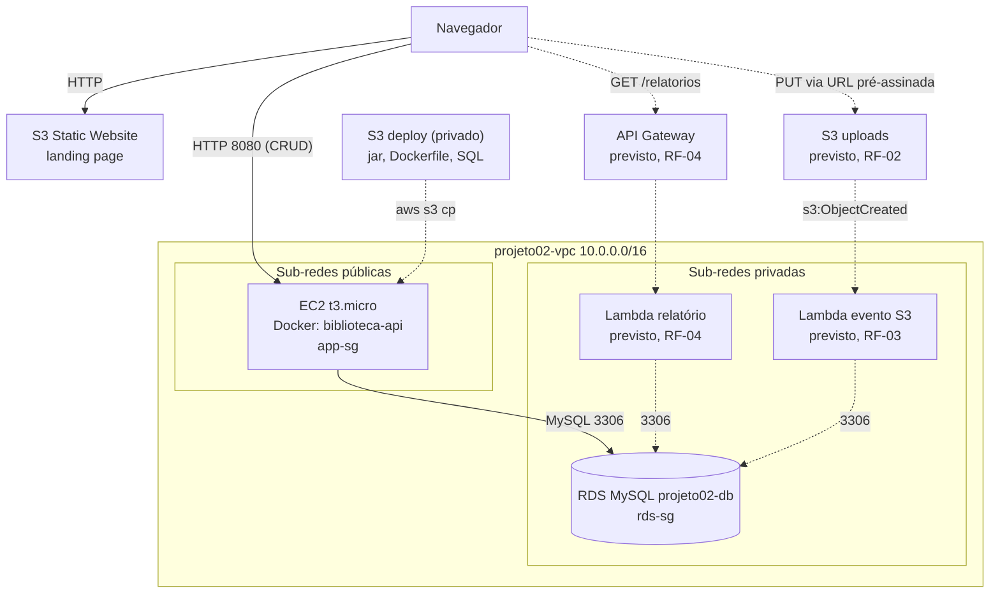
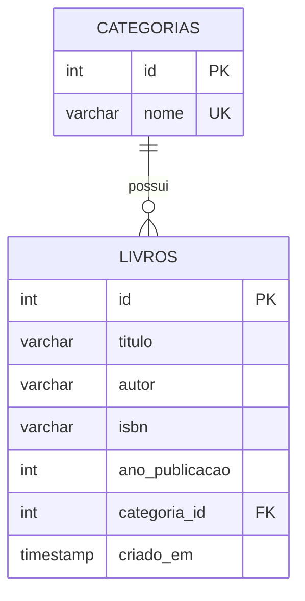

# Design: Biblioteca na AWS

## 1. Arquitetura

- **Rede:** VPC `projeto02-vpc` (`10.0.0.0/16`) com 4 sub-redes em 2 zonas de disponibilidade: 2 públicas (rota `0.0.0.0/0` para a Internet Gateway) e 2 privadas (sem saída para a internet). Sem NAT Gateway. Endpoint de VPC do tipo Gateway para o S3.
- **Em funcionamento:** EC2 `t3.micro` (Amazon Linux 2023, perfil IAM `LabInstanceProfile`) com a API Spring Boot em Docker (CRUD de `categorias` e `livros`), RDS MySQL privado e landing page estática no S3.
- **Deploy:** o jar, o Dockerfile e os scripts SQL são enviados a um bucket S3 privado e baixados pela EC2.
- **Previsto:** as Lambdas ficam nas sub-redes privadas, usam a `LabRole` e um novo `lambda-sg`. O `rds-sg` ganhará uma regra de entrada 3306 vinda do `lambda-sg`.

## 2. Modelo de dados (ER)

Relação 1:N: uma categoria tem vários livros. A chave estrangeira impede excluir uma categoria que ainda tenha livros. Scripts versionados em `sql/001_schema.sql` (tabelas) e `sql/002_schema.sql` (dados de exemplo).

## 3. Rotas da API

| Método | Rota | Descrição |
|---|---|---|
| GET | `/categorias` | Lista categorias |
| GET | `/categorias/{id}` | Busca uma categoria |
| POST | `/categorias` | Cria categoria |
| PUT | `/categorias/{id}` | Atualiza categoria |
| DELETE | `/categorias/{id}` | Exclui categoria |
| GET | `/livros` | Lista livros (com a categoria) |
| GET | `/livros/{id}` | Busca um livro |
| POST | `/livros` | Cria livro (`categoria: {id}`) |
| PUT | `/livros/{id}` | Atualiza livro |
| DELETE | `/livros/{id}` | Exclui livro |

CORS liberado na API (`@CrossOrigin`). As credenciais do banco são lidas somente de variáveis de ambiente (`DB_HOST`, `DB_USER`, `DB_NAME`, `DB_PASSWORD`).

## 4. Security Groups (na `projeto02-vpc`)

| Grupo | Entrada | Origem | Justificativa |
|---|---|---|---|
| `app-sg` | TCP 8080 | `0.0.0.0/0` | Acesso à API |
| `app-sg` | HTTP 80 | `0.0.0.0/0` | Reservado para acesso web |
| `app-sg` | SSH 22 | `0.0.0.0/0` | EC2 Instance Connect (Learner Lab) |
| `rds-sg` | MySQL 3306 | `app-sg` | O banco só aceita recursos com o `app-sg`, sem depender de IP |

A regra de saída de ambos é a padrão (todo o tráfego).

## 5. ADRs

### ADR-01 (RNF-04): CRUD em EC2 com Docker, e não em Lambda

- **Status:** aceito. Substitui a proposta inicial (Aula 2) de CRUD em Lambda + API Gateway.
- **Contexto:** a API é Java com Spring Boot e JPA, com conexão persistente ao RDS.
- **Decisão:** executar o CRUD em um contêiner Docker numa EC2.
- **Motivos:**
  - Spring Boot em Lambda tem *cold start* da JVM de vários segundos e exige adaptação no empacotamento.
  - A EC2 mantém o pool de conexões com o banco, sem abrir uma conexão por invocação.
  - O contêiner dá um deploy reprodutível (`docker build` e `docker run`) e reinicia sozinho (`--restart unless-stopped`).
- **Alternativa considerada:** Lambda + API Gateway. Tem vantagens reais (só consome quando é chamada e a URL do API Gateway não muda entre sessões), mas é pior para este stack.
- **Consequências e mitigações:**
  - A EC2 consome orçamento enquanto estiver ligada: encerrar a sessão do Lab ao terminar de usar.
  - O IP público muda a cada sessão: nada está fixo no código, e o README descreve como atualizar a URL da API. Quando o front-end passar a consumir a API (RF-05), a URL ficará em um arquivo de configuração (`config.js`).
- **Onde Lambda continua sendo usada:** tarefas curtas e orientadas a evento (processamento do arquivo no S3 e relatório).

### ADR-02: banco em sub-rede privada

- **Status:** aceito.
- **Decisão:** o RDS fica nas sub-redes privadas, sem IP público, e só recebe conexões vindas do `app-sg` (e, futuramente, do `lambda-sg`).
- **Consequência:** reduz a superfície de ataque, ao custo de só poder ser administrado a partir de uma máquina dentro da VPC (a EC2).

## 6. Estado da implementação

| Item | Estado |
|---|---|
| RF-01 CRUD de 2 entidades no RDS | Em funcionamento na AWS |
| RNF-01 RDS privado e Security Groups documentados | Atendido |
| RNF-02 Sem senhas no repositório | Atendido |
| RNF-04 ADR | Atendido (ADR-01) |
| RF-02 Upload via URL pré-assinada | Previsto |
| RF-03 S3 → Lambda → RDS | Previsto |
| RF-04 Relatório (API Gateway + Lambda) | Previsto |
| RF-05 Front-end consumindo a API | Em andamento (landing page estática publicada no S3; ainda não consome a API) |